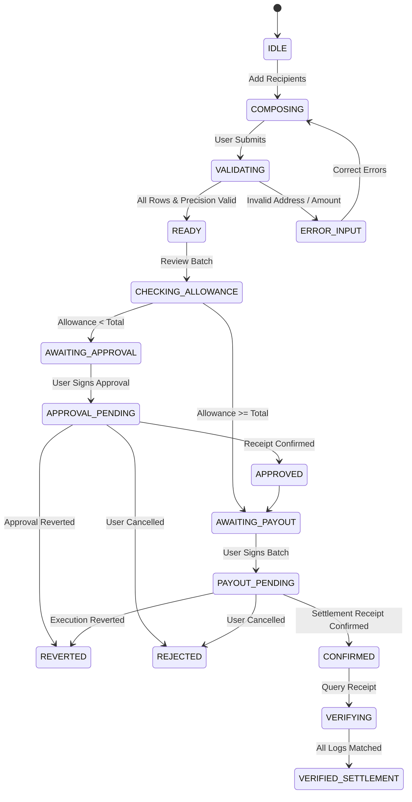

# Pariter — Payment Lifecycle & Settlement Flow

**Document:** End-to-End Payout State Machine and Verification Protocol  
**Date:** 2026-10-11  

---

## 1. Payout Lifecycle State Machine

The client application enforces a strict, linear state machine for all payment operations. States cannot be bypassed or assumed optimistically.

---

## 2. Step-by-Step Execution Sequence

### Phase 1: Input Composition & Precision Validation
1. Operator inputs recipient addresses, amounts in USDC, and optional local line-item descriptions.
2. Input parser enforces:
   - Valid EVM address checksums (EIP-55).
   - Non-zero addresses.
   - Positive USDC amounts with at most 6 decimal places.
   - Batch size $\le 250$.
   - Duplicates flagged with visual advisory indicators.
3. Total calculated in integer base units (`bigint`).

### Phase 2: Batch Review & Gas Estimation
1. Current ERC-20 USDC allowance is queried for `BatchPayout` spender.
2. Gas is estimated using live Arc RPC `eth_estimateGas`.
3. Operator reviews:
   - Payer address and connected network (must be Arc Mainnet `5042`).
   - Line items and exact sum.
   - Estimated gas cost in native USDC.
   - Approval requirement (Exact amount approval requested by default).

### Phase 3: Exact-Amount Approval (if required)
1. Spender: `BatchPayout` contract address.
2. Amount: Exact `totalTransferred` required for the batch.
3. Transaction submitted; client waits for block inclusion.

### Phase 4: Atomic Batch Settlement
1. Client computes unique `batchId = keccak256(abi.encode(payer, nonce, timestamp))`.
2. Client computes `referenceCommitment = keccak256(memoBytes)`.
3. `executeBatch` is invoked via wallet.
4. Transaction is broadcast to Arc Mainnet.
5. Onchain execution:
   - Verification checks passed.
   - `safeTransferFrom` transfers `totalTransferred` from payer.
   - Loop executes `safeTransfer` to each recipient.
   - Contract verifies 0 residual balance.
   - Emits `BatchSettled` and $N \times$ `PayoutExecuted`.
6. Client awaits block confirmation receipt.

### Phase 5: Independent Verification
1. Settlement verifier retrieves receipt by transaction hash.
2. Re-verifies emitting contract, transaction status (`0x1`), batch ID, and logs.
3. Reconciles emitted events against underlying USDC ERC-20 transfer logs.
4. Generates cryptographic receipt exportable as JSON.
